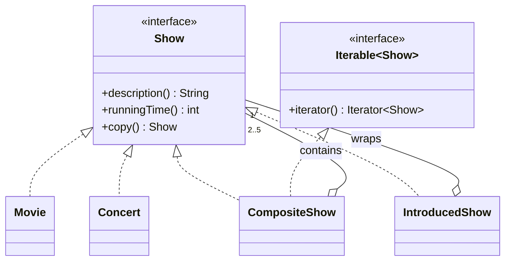
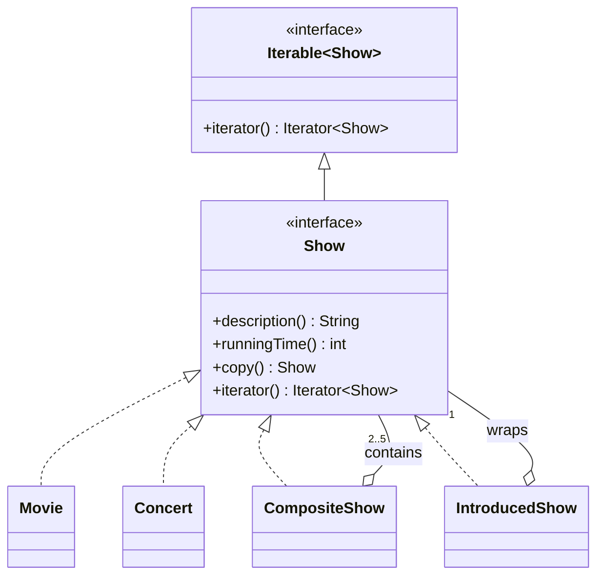

# Sơ đồ lớp để đưa vào báo cáo (Mermaid)

## Exercise 6 — Không sửa interface Show

## Exercise 7 — Interface Show kế thừa Iterable

Dán mã vào https://mermaid.live/ hoặc app.diagrams.net -> Arrange -> Insert -> Advanced -> Mermaid.
